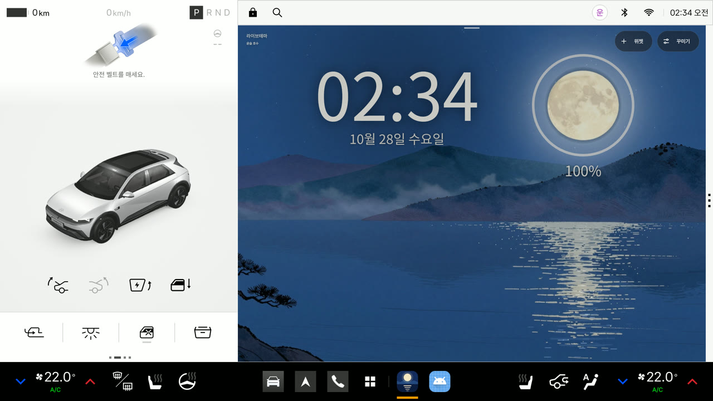
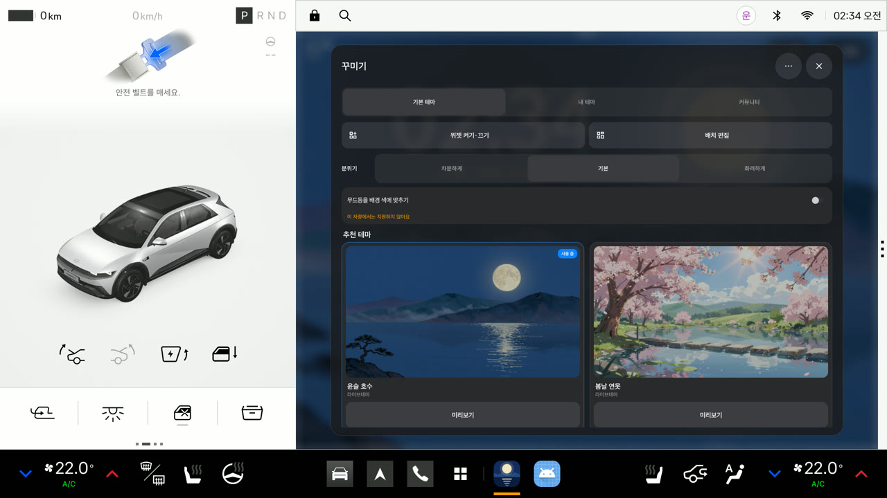
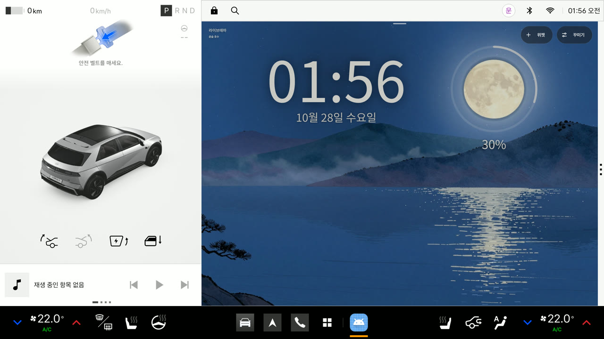
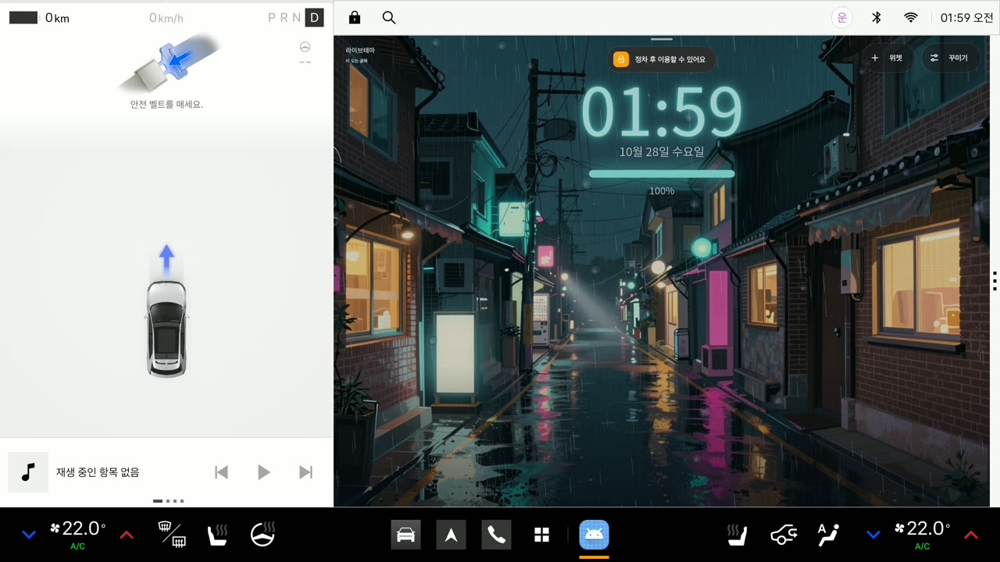
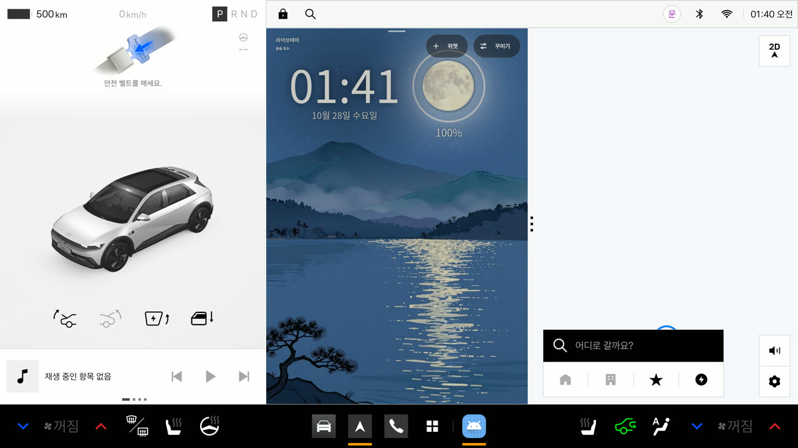

# 라이브테마 (LiveTheme)

**차 화면을 살아 움직이는 배경으로 꾸미고, 충전량·주행 상태·음악에 배경이 반응하는 Pleos Connect 개인화 앱.**

| 첫 실행 · 윤슬 호수 | 기본 테마: AI 테마 5종 |
|---|---|
|  |  |
| **충전량 30% → 달 둘레 링** | **기어 D: 움직임 정지 · 편집 잠금** |
|  |  |
| **3분할 841×1210 · 세로 그림** | |
|  | |

<sub>Pleos Connect 에뮬레이터 v2.1.0 화면 캡처. 충전량·기어는 에뮬레이터의 Virtual Console로 바꾼 값이에요.</sub>

- 움직이는 웹 테마 5종(윤슬 호수·봄날 연못·비 오는 골목·눈 내린 숲·픽셀 노을)을 앱에 내장했어요. 배경 안의 시계·충전량·곡 정보가 차량 데이터로 바뀌어요.
- 시계·캘린더·메모·D-day·날씨·음악·배터리·무드등·내비 위젯을 창 크기(3분할·2분할·전체화면)별로 따로 배치해요.
- 기어 D(주행 제한)에서는 움직임을 멈추고 시계·음악·충전량만 남기며, 편집·입력·차량 제어 창을 막아요.
- PC 테마 제작실에서 코드 없이 색·글꼴·위젯·데이터 연결을 고르고 ZIP으로 내보내 차에서 가져올 수 있어요.

## 1. 실행 방법

### APK 설치 (바로 실행)
```bash
adb install apk/라이브테마팀_라이브테마_release.apk
```
앱 목록의 **라이브테마**를 엽니다. 처음 실행하면 '윤슬 호수' 테마로 시작해요.
- 테마 바꾸기: 오른쪽 위 **꾸미기 → 기본 테마** → 카드 → **이 테마 적용**
- 위젯 추가: **위젯** 버튼 또는 배경 길게 누르기
- 빠른 설정: 화면 위쪽 가운데 띠를 아래로 끌기

### 소스에서 빌드
- JDK 17, Android SDK 34(build-tools 35), Gradle Wrapper 8.13, AGP 8.13.2
- Pleos SDK는 `settings.gradle`의 Pleos playground Maven 저장소에서 받아요(`ai.pleos.playground:Vehicle:2.3.2`, `NaviHelper:3.0.5`, `FusedLocation:1.1.3`).
```bash
./gradlew :app:assembleDebug      # 개발용 (versionName 1.38-preview)
./gradlew :app:assembleRelease    # 제출용 1.39 / versionCode 41
```
- 버전 번호: `app/build.gradle`의 `defaultConfig`(versionCode 40 / 1.38-preview)는 개발용 debug 값이고, release만 `androidComponents`에서 41 / 1.39로 덮어써요. 개발용 debug 빌드는 그대로 두고 제출 빌드만 따로 올리려고 나눴어요.
- release 서명: `local.properties`에 `release.signing=<keystore.properties 경로>`를 적으면 그 파일의 `storeFile/storePassword/keyAlias/keyPassword`로 서명해요. 없으면 서명되지 않은 APK가 나와요. 키와 비밀번호는 저장소에 넣지 않아요.
- release 빌드에만 들어가는 것(`app/src/release/`): 내장 AI 테마 5종 ZIP, 앱 아이콘, 첫 실행 기본 테마, 웹 테마 런타임 수정본.
- 이 저장소와 release APK에는 예전 기본 영상 배경 3종(달빛 연못·빗속 창가·노을 바다)을 넣지 않았어요. 그 영상은 Wallpaper Engine 편집기로 저작·녹화한 것이라 출력물 이용 조건을 확인하지 못했기 때문이에요. 그래서 debug 빌드에서 그 배경을 고르거나 `builtin` 배경을 쓰는 예제(`creator-kit/editor/samples.json`, `snow-clock`, `stacked-mono`)를 쓰면 "배경 영상을 열 수 없습니다"가 나오고 배경 영상 없이 위젯만 보여요. 테마는 내장 AI 웹 테마나 직접 고른 MP4로 쓰세요.

### PC 테마 제작실
```bash
python community/server.py --port 8787
```
브라우저에서 `http://127.0.0.1:8787/creator/`를 열어요(Windows는 `creator-kit/제작기_실행.cmd`). 이 PC에서만 쓰는 로컬 테스트 서버예요.
- 웹 샘플 목록은 `creator-kit/web-samples/<id>/`(live-theme.json + web/)에서 자동으로 읽어요. 이 저장소에는 기본 영상 배경이 없어서 제작실의 배경은 웹 샘플이나 내 MP4로 골라요.
- **테마 ZIP 내보내기**로 만든 ZIP을 차량에서 다른 앱의 '공유'로 라이브테마에 보내면 확인 후 설치돼요(Pleos 에뮬레이터에는 파일 선택기가 없어 공유 방식만 지원).

## 2. 테스트 환경과 필요한 설정

| 항목 | 내용 |
|---|---|
| 에뮬레이터 | Pleos Connect v2.1.0 시스템 이미지 (android-34, `pleos_car_emulator`, x86_64), 화면 2560×1440, RAM 4GB, 운전자 사용자(user 10) |
| 창 크기 | 3분할 841×1210 · 2분할 1682×1210 · 전체화면 2560×1439 (Pleos 창 핸들·전체화면 전환 버튼 사용) |
| 권한 | `pleos.car.permission.*`(CAR_ENERGY, CAR_LIGHTS, CONTROL_CAR_LIGHTS, CAR_DRIVE, NAVI_ROUTE, NAVI_CUSTOM_MAP)은 설치 시 허용됨. 위치(날씨)·`android.car.permission.CAR_ENERGY`(충전 상태)는 앱 안에서 동의 후 요청 |
| 차량 값 바꾸기 | 에뮬레이터 안 Virtual Console(`ai.pleos.connectwebconsole`, 포트 8088). PC에서 `adb forward tcp:8088 tcp:8088` 후 `http://127.0.0.1:8088/` |
| 주행 모드 | Virtual Console 기어 D → `CarUxRestrictions` DO 필요(UxR 0x80). 매니페스트에서 MainActivity만 `distractionOptimized=true` |
| 네트워크 | 날씨 위젯만 인터넷(Open-Meteo) 사용. 웹 테마는 기기 안에서만 실행(외부 요청 없음) |
| 곡 정보 | 알림 접근(`SongAccessService`)을 사용자가 허용해야 다른 앱의 재생 정보를 읽어요. 앱은 소리를 녹음·분석하지 않아요 |

### 에뮬레이터에서 확인한 것 / 안 된 것 (2026-10-28, release 1.39)
- 확인: 새로 설치 → 첫 실행(윤슬 호수), AI 테마 5종 적용과 3가지 창 크기, Virtual Console **충전량(SOC)** 변경 → 배경의 충전량 표시 반영, **기어 D** → 앱이 가려지지 않고 움직임 정지·편집 차단, P로 돌아오면 복귀.
- 안 됨(에뮬레이터 한계): **충전 중 표시**(Virtual Console이 `EV_CHARGE_STATE`를 내보내지 않음), **무드등 색 반응**(에뮬레이터의 Vehicle SDK가 무드등을 '지원 안 함'으로 알려 줌). 두 기능은 PC 제작실의 가상 차량 패널로 확인했어요. 실차 확인은 하지 못했어요.

### 자동 검사
```bash
node creator-kit/editor/checks.cjs            # 편집기 검증·ZIP 허용 목록
node creator-kit/editor/links-checks.cjs      # 데이터 연결·무드등 색 맞춤
node creator-kit/editor/regression-checks.cjs # 편집기 회귀
node creator-kit/editor/runtime-checks.cjs    # 웹 테마 런타임(30fps 상한, 주행 정지, 정보만 갱신)
node creator-kit/editor/groove-checks.cjs     # 가상 그루브
python community/checks.py                    # 로컬 서버 패키지 검사
./gradlew -I checks/fix-checks.init.gradle :fix-checks:assembleDebug     # 기기 검사 앱 1 (io.hmg.fixchecks)
./gradlew -I checks/engine-probe.init.gradle :engine-probe:assembleDebug # 기기 검사 앱 2 (io.hmg.engineprobe)
```
기기 검사 앱은 앱 소스를 그대로 컴파일한 별도 패키지예요. 에뮬레이터에 설치한 뒤 `am start --user 10 -n io.hmg.fixchecks/io.hmg.wallpaperapp.FixChecksActivity`, `am start --user 10 -n io.hmg.engineprobe/.MainActivity --ez themeChecks true`(또는 `catalogChecks`, `widgetChecks`, `shapeChecks`, `weatherChecks`, `creatorChecks`, `motionChecks`)로 실행하고 logcat의 `PASS`/`DONE` 줄을 봐요.

## 3. APK 위치

`apk/라이브테마팀_라이브테마_release.apk` — 라이브테마 1.39 (versionCode 41), 12,524,195 B
SHA256 `4B407B0490CF77A90D0E938001B1BDD541AD99A3C932ACDB126134D729EB0411`
서명 인증서 SHA-256 `3f32abf62db5b1188f3bc26470d410445768e0a5033662ef8878f72ebf883b15` (APK Signature Scheme v2)

제출 APK는 `v1.39-submitted` 태그(소스 커밋 `a2eeded`)에서 빌드했어요. 그 뒤 커밋은 문서와 저장소 설정(`.gitattributes`, `.gitignore`)만 바꿨고 앱 소스는 그대로예요. 이 저장소에서 서명 없이 다시 빌드한 release APK의 `classes.dex`와 리소스·assets는 제출 APK와 바이트까지 같아요(서명 파일과 git 커밋 기록 파일 `META-INF/version-control-info.textproto`만 달라요, 2026-11-08 확인).

## 4. 자산·모델·음원 출처

| 자산 | 출처 · 라이선스 |
|---|---|
| AI 웹 테마 5종 배경 그림 (`creator-kit/web-samples/{yunseul-lake,spring-pond,rain-alley,snow-valley,pixel-sunset}/web/*.webp`) | 팀이 로컬 PC에서 **Z-Image-Turbo**(Tongyi-MAI, **Apache-2.0**)로 직접 생성. 풍경 묘사 프롬프트만 사용, 특정 작가·작품·캐릭터 이름 없음, 사람·동물·글자·로고 없음. seed·해상도 기록: `creator-kit/웹테마_배경_출처.txt` |
| 움직임 마스크 `*-mask.png` | 위 그림에서 색·위치로 자동 계산 |
| 웹 테마 코드 (`scene.js`, `common.js`, `plate.js`) | 팀 작성 |
| WebWallGL 3.0.0 | MIT (`app/src/main/assets/engine/WebWallGL-LICENSE.txt`) |
| WebWallGL에 포함된 we-scene 코드 | MIT, aurora-wallpaper contributors (`app/src/main/assets/engine/ThirdParty-LICENSE.txt`, WebWallGL 저장소의 `renderer/vendor/we-scene/LICENSE`와 같은 파일) |
| 글꼴 | 앱에 글꼴 파일 없음. 시스템 Noto Sans CJK(SIL OFL 1.1) 사용 (`creator-kit/글꼴_라이선스.txt`) |
| 아이콘 | 앱 아이콘·UI 아이콘 모두 팀이 직접 그린 벡터 (`app/src/release/res/`, `app/src/main/res/drawable/ic_*.xml`) |
| 데모 영상 음원 | Pixabay(Pixabay Content License, 상업 사용 가능·크레딧 불필요·음원 단독 재배포 금지). **APK·테마 ZIP에는 음원 없음.** 곡 목록은 아래 |
| Pleos SDK | `ai.pleos.playground` Vehicle 2.3.2 · NaviHelper 3.0.5 · FusedLocation 1.1.3 (Pleos playground 배포본) |
| AndroidX DynamicAnimation 1.1.0 | Apache-2.0 |

데모 영상 음원 (Pixabay): Korean - Korea Korean Music / lNPLUSMUSIC · Cherry blossom picnic / ECO-ART · night coffee shop / Lofi_hour · Winter Days / KitKatMusic · Video Game Pixel Chiptune Music / alex-morgan (Pixabay 표기상 AI 생성곡).

### 창작마당(Wallpaper Engine Workshop) 관련
- 저장소와 APK에 창작마당 작품 파일(그림·음악·스크립트)은 **하나도 없어요.**
- 개발용 debug 빌드에는 사용자가 자기 PC에 받은 작품을 번호로 참조해 미리 보는 기능이 있지만, 제출용 release 빌드에서는 그 프리셋과 메뉴를 숨겼어요(`BundledThemes.present`).
- AI 테마 5종은 창작마당 작품의 연출 기법(물결 마스크, 유리 카드 등)만 참고해 새로 만들었어요.

## 폴더 구조

```
app/                 안드로이드 앱 (main = 공통, debug = 로컬 서버 평문 허용, release = 제출용 내장 테마·아이콘)
creator-kit/         PC 테마 제작실(editor/), 웹 테마 샘플(web-samples/), 예제 ZIP, 제작 안내
community/           로컬 테스트 서버(server.py)와 검사(checks.py), 기본 위젯 스타일 템플릿(presets.json)
checks/              기기 검사 앱 2개와 Gradle init 스크립트
apk/                 제출용 release APK
docs/screenshots/    이 README의 에뮬레이터 화면 캡처
gradle/wrapper/      Gradle Wrapper(8.13)
```

### 같은 파일이 두 곳에 있는 이유

| 파일 | 위치 | 이유 |
|---|---|---|
| AI 테마 ZIP 5개 | `creator-kit/<id>.zip` · `app/src/release/assets/bundled-themes/N-<id>.zip` | 앞은 제작실에서 열어 보는 예제, 뒤는 release APK에 내장하는 사본(앞 번호는 앱이 이름순으로 읽는 순서) |
| `webwallgl.global.min.js`, `WebWallGL-LICENSE.txt` | `app/src/main/assets/engine/` · `checks/engine-probe/src/main/assets/` | 앱과, 앱과 따로 빌드하는 엔진 검사 앱이 각각 자기 assets에 들고 있어야 해요 |
| 웹 테마 공통 스크립트(`common.js`, `plate.js`, `sketch.js`) | `creator-kit/web-samples/<id>/web/` | 웹 테마는 폴더 하나가 그대로 테마 ZIP이 되므로 테마마다 자기 사본을 가져요 |
